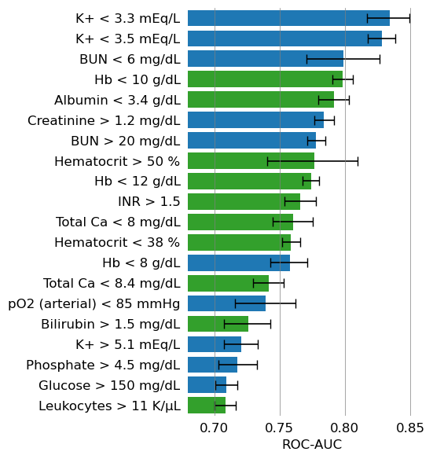
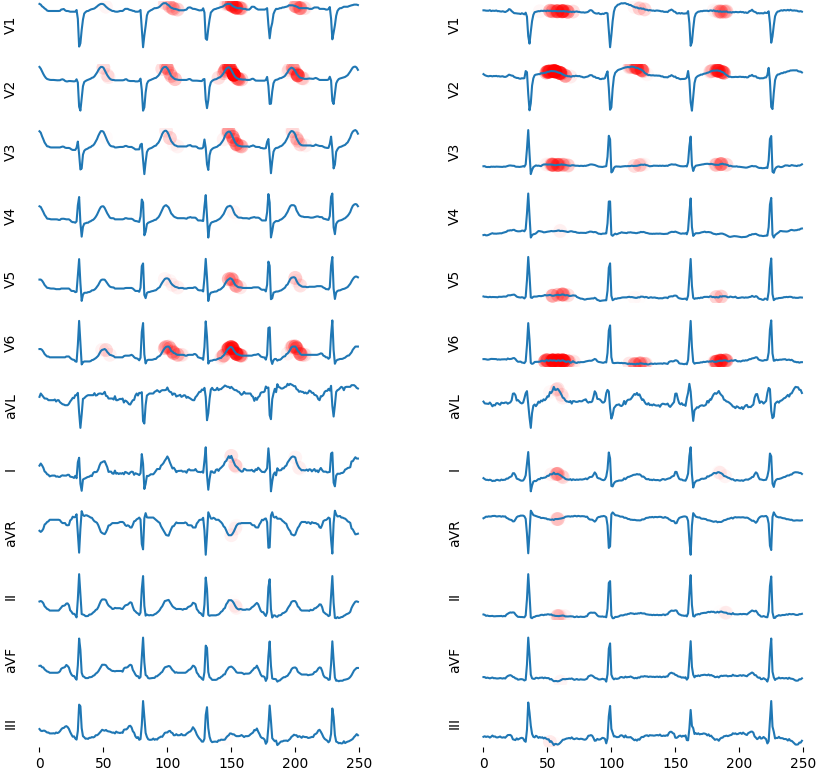

# lab-ecg: Estimate Laboratory Parameters from ECG Signals

Train and evaluate deep learning models that determine the (ab)normality of laboratory blood parameters from concurrent ECG signals.

- ⚕️ **Training and internal validation**: MIMIC-IV clinical database with MIMIC-IV-ECG 12-lead waveforms.
- 🧪 **External validation**: MIMIC-III clinical database with matched MIMIC-III-WDB waveforms (lead II only).
- 🎯 **Targets**: a portfolio of parameter/threshold combinations (e.g. `hemoglobin < 10 g/dL`, `potassium > 5.1 mEq/L`); see `TARGETS` in `lab_ecg/__init__.py`.
- 📦 **Package**: `lab_ecg` provides the data infrastructure (HDF5 datastores, transforms), the model zoo (`xresnet1d101`, `kwon`), and evaluation utilities.

## Installation

Python 3.11 is required. The project is managed with [uv](https://docs.astral.sh/uv/):

```bash
uv sync
```

CUDA-enabled PyTorch is installed from the PyTorch CUDA 12.6 index configured in `pyproject.toml`. A [dev container](.devcontainer/) that sets up the full environment (including GPU support) is included.

## Data

MIMIC-IV and MIMIC-III are restricted-access databases (credentialed download from [PhysioNet](https://physionet.org/)); the waveform databases MIMIC-IV-ECG and MIMIC-III-WDB are openly available. After being granted access, download the restricted clinical data and run the preparation notebooks below to build the HDF5 files needed for training and evaluation.

## Notebooks

Run the notebooks in this order:

1. **prepare_mimic4.ipynb** — attach restricted MIMIC-IV clinical data (demographics, laboratory values, specimen types) to `data/mimic4_samples_pre.h5`, producing `data/mimic4_samples.h5`; then build `data/mimic4_signals.h5` from MIMIC-IV-ECG.
2. **prepare_mimic3.ipynb** — the MIMIC-III analogue for external validation, producing `data/mimic3_samples.h5`.
3. **train.ipynb** — train a model (`xresnet1d101` by default, or `kwon`) on MIMIC-IV for a parameter/threshold target of your choice; checkpoints and `params.yaml` are written to `checkpoints/`.
4. **evaluate.ipynb** — evaluate a trained model on held-out test data from MIMIC-IV or MIMIC-III, including bootstrapped confidence intervals and gradient-based saliency maps.
5. **forecast.ipynb** — *optional* non-ECG baseline that predicts the (ab)normality of the current value from the last measurement of the same parameter taken 2–36 hours earlier.

## Key Results

Trained on MIMIC-IV, the models achieve strong discrimination across some of the target parameters. The figure below shows the bootstrapped AUROCs of 12-lead models on MIMIC-IV test data.



The saliency maps below localize the ECG regions a model attends to when classifying abnormally low potassium (`K+ < 3.5 mEq/L`). The left shows a true negative example, the right shows a true positive example. As can be seen, the model mainly attends to the T-wave, a well-known marker for potassium deficiency.



## References

A manuscript is currently under review for publication.

## Related Work

* [CardioLab](https://github.com/AI4HealthUOL/CardioLab): same objective, but restricted to MIMIC-IV, no temporal train/val/test split, different neural network architecture

## Contact

If you have any inquiries, please open a GitHub issue.

## Acknowledgments


This project was funded by the FFG (Austrian Research Promotion Agency) under grant 902677 (AIMS). The project was also funded by research subsidies from the government of Upper Austria. RISC Software GmbH is a Member of UAR (Upper Austrian Research) Innovation Network.

## Disclaimer

This software is provided for **research purposes only**. It is not a medical device and must not be used for clinical practice, diagnosis, or treatment decisions. The authors and contributors assume no liability for any use of this repository or its outputs.